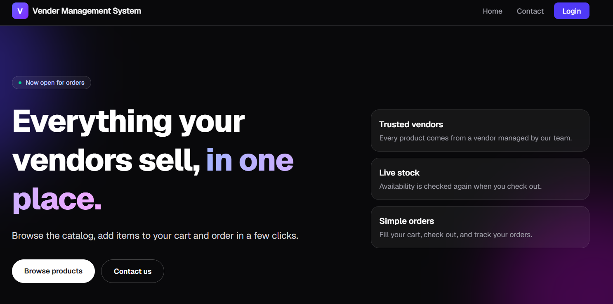
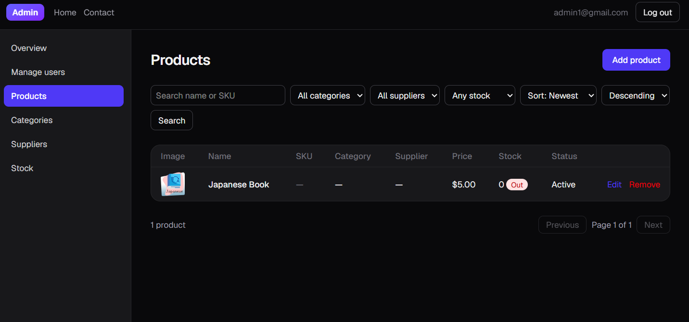

# Vender Management System

Vendor and product catalog with a public home page, admin panel, user/staff dashboard (cart, orders) and inventory. Built with Next.js, Tailwind CSS and MySQL.





## Quick start

1. `npm install`
2. Copy `.env.example` to `.env.local` and fill it in.
3. In MySQL Workbench, as **root**, run the files in `db/` in this order:
   `schema.sql`, `002`, `003`, `004`, `005`, `007`, `008`, `009`.
   Set the password in `schema.sql` first, and use the same one for `DB_PASSWORD`.
4. `npm run dev`, then open http://localhost:3000

## Roles

- **User**: public sign-up.
- **Staff**: sign up at `/admin/register` with `STAFF_INVITE_CODE`.
- **Admin**: sign up at `/admin/register` with `ADMIN_INVITE_CODE`.

Both codes must be 20+ characters and different from each other.

## Tests

```
npm run build
npm test
```

Details and status: `implement-plan.md`.